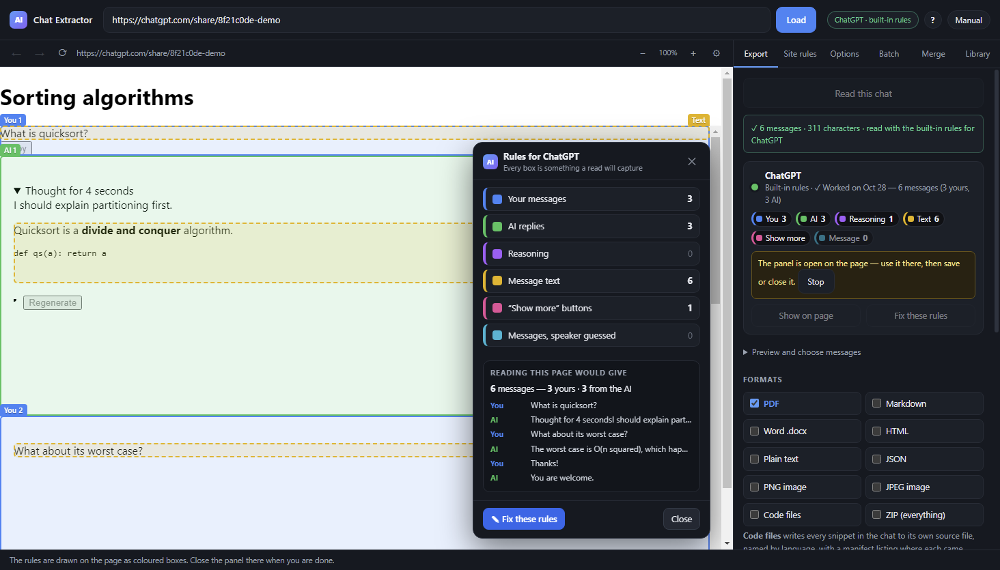

<div align="center">


# AI Chat Extractor

**Export any AI conversation to PDF, Word, Markdown, HTML, JSON, images — or a folder of runnable source files.**

Works with ChatGPT, Claude, Gemini, DeepSeek, Grok, Copilot, Perplexity, Poe, Qwen,
Le Chat, Kimi, GapGPT — and anything else you point it at, in a few clicks.

[](https://github.com/amirtavakolihaghighi/ai-chat-exporter/actions/workflows/ci.yml)
[](CHANGELOG.md)
[](LICENSE)

[Manual](docs/MANUAL.md) · [Troubleshooting](docs/TROUBLESHOOTING.md) · [Architecture](docs/ARCHITECTURE.md) · [Testing](docs/TESTING.md) · [Publishing](docs/PUBLISHING.md) · [Changelog](CHANGELOG.md)

</div>



---

Everything runs locally. No account, no server, no telemetry. Neither product
makes a network request of its own — the only fetches are for images inside the
chat you are exporting.

## Two ways to use it

| | **Browser extension** | **Desktop app** |
| --- | --- | --- |
| | Chrome · Edge · Firefox | Windows |
| Getting a chat in | You are already on the page | Paste a share link, or sign in inside the app |
| Private chats | Immediate — your own session | Sign in inside the app once |
| Output location | Downloads only | Any folder |
| PDF | Print dialog | Automatic, with page numbers |
| Full-page images | Stitched, slower | One operation |
| Best for | Everyday exporting | Bulk PDFs, images, a chosen folder |

They share the same extraction engine and the same document builders, and each
can merge the other's JSON exports.

## Quick start

```bash
git clone https://github.com/amirtavakolihaghighi/ai-chat-exporter.git
cd ai-chat-exporter
npm install
npm run icon          # once — generates the icons
```

**Extension**

```bash
npm run ext:build
```

- **Chrome / Edge** — `chrome://extensions` → Developer mode → **Load unpacked** → `extension/dist/chrome`
- **Firefox** — `about:debugging#/runtime/this-firefox` → **Load Temporary Add-on** → `extension/dist/firefox/manifest.json`

Open a chat, click the toolbar button, **Read this chat**.

**Desktop app**

```bash
npm start             # run it
npm run dist          # build installer + portable .exe into dist/
```

## What it does

- **Reads the whole conversation**, including the parts not on screen. Long chats
  are *virtualised* — sites delete off-screen messages — so the reader scrolls
  and harvests continuously when it has to, then checks its own coverage and
  re-reads anything it might have missed.
- **Choose the messages** you want with tick boxes and presets (answers only, your
  prompts, invert).
- **Ten formats**, including `.docx` that is real OOXML and code files extracted as
  runnable sources.
- **Keeps your images**, because share links hand out URLs that expire.
- **Searches everything you have exported**, full text.
- **Merges several chats** into one document with a table of contents.
- **Redacts** before writing, with literal or regex rules.
- **Right-to-left** Persian, Arabic and Hebrew in HTML, PDF and Word.
- **Reads every site with rules you can see and fix.** Which parts of a page are
  your messages, the AI's replies, its reasoning, or furniture to leave out is
  shown on the page as coloured boxes. When a site redesigns, the app says so
  instead of reading the wrong thing, and proposes rules for the new layout —
  fixing it is checking the colours and pressing Save.
- **Manages those rules**: keep several rule sets for a site and choose which
  one reads it, see what each found last time, go back to the built-in ones,
  remove or restore them, and import or export rules as files.
- **Keeps its files in one place**: settings, site rules, the library and
  exports, each in its own folder inside `data/` in the project (or wherever you
  choose). In Chrome and Edge the extension can keep its options, rules and
  exports there too, sharing one set of site rules with the desktop app.
  Default options are in `config/default-settings.json`.
- **Explains itself**: the full manual is inside the app (F1), and "What's
  this?" mode explains any button you click.

See the [manual](docs/MANUAL.md) for how each of these works.

## Provider support

Built-in rules are a best-effort starting point, not a contract — these sites
change their pages regularly. Verified means a real conversation has been
exported and checked end to end.

| Provider | Status |
| --- | --- |
| GapGPT | Verified — dedicated rules, including its one-element-per-exchange layout |
| ChatGPT, Claude, Gemini, DeepSeek, Grok, Copilot, Perplexity, Poe, Qwen, Le Chat, Kimi | Rules written, not all individually verified |
| LibreChat, Open WebUI and other re-skins | Generic rules |
| Anything else | Taught in a few clicks, starting from the app's own guess |

If a site cannot be taught reliably, export its rules and run
[`docs/site-report.js`](docs/site-report.js) on the chat, so built-in rules can
be written for it — see [Troubleshooting](docs/TROUBLESHOOTING.md).

## When a site changes its design

Chat sites redesign constantly, so rules are checked on every read, and a rule
that stops working stops loudly rather than guessing behind your back:

1. **Site rules** — built-in, taught or imported — say which parts of the page
   are which. Each read reports what every part found.
2. **Rules that find nothing** stop the read and say so, with one button to fix
   them: the app proposes rules for the new layout, drawn on the page in colour,
   and saving them reads the chat again. The built-in rules are never edited;
   your fixed copy takes their place.
3. **A site with no rules** is guessed — skipping sidebars, menus and lists of
   links — and the result is marked as a guess, with a button to teach the site.
4. **Capture as shown** — a screenshot needs no parsing at all.

Everything about rules is managed in the **Site rules** tab of either app.

## Development

```bash
npm test               # conversion core, site rules, help coverage — plain Node, fast
npm run test:electron  # the real extractor against DOM fixtures, plus capture
npm run test:e2e       # boots the real app and drives the real UI to files
npm run test:extension # manifests, built bundles, browser-side exports
npm run bench          # reading speed and completeness
```

Architecture and the reasoning behind the awkward parts:
[docs/ARCHITECTURE.md](docs/ARCHITECTURE.md). Contributions:
[CONTRIBUTING.md](CONTRIBUTING.md).

Automated tests cannot cover the thing most likely to break — extraction from
real, frequently-redesigned provider sites. [docs/TESTING.md](docs/TESTING.md) is
a hand-testing checklist for exactly that.

## Repository layout

```text
src/                  desktop app + the shared core
  shared/             site rules, shared interface pieces, help, text direction
  inject/             scripts that run inside the chat page: reading and teaching
  main/               Electron main process, converters, exporters
  renderer/           desktop UI
extension/            browser extension (imports the same core)
config/               default-settings.json: the options both apps start with
data/                 your settings, rules, library and exports when run from here (not committed)
scripts/              build helpers
docs/                 manual (also shown inside both apps), testing, architecture, troubleshooting
test/                 suites, fixtures, benchmark
```

## Known limitations

- **The chat tab must stay in front while reading.** Browsers throttle background
  tabs so hard that chat sites stop redrawing, so the extension brings the tab
  forward and returns you afterwards.
- **Extensions cannot choose an output folder on their own.** In Chrome and Edge
  you can give the extension a folder in its Options; otherwise — and always in
  Firefox — everything goes to `Downloads/AI Chat Exports/`.
- **PDF from the extension goes through the print dialog.** Quality is identical —
  same print engine — but it is not automatic and there is no page-number footer.
- **"As shown" capture of a long chat may be partial**, since it can only include
  what the site currently has in the page. Clean mode has no such limit.
- **Nothing is code-signed.** SmartScreen will warn on first run.

## Licence

[MIT](LICENSE).

Not affiliated with OpenAI, Anthropic, Google, or any other provider. Please
respect the terms of service of the sites you export from, and other people's
privacy when sharing a conversation.
